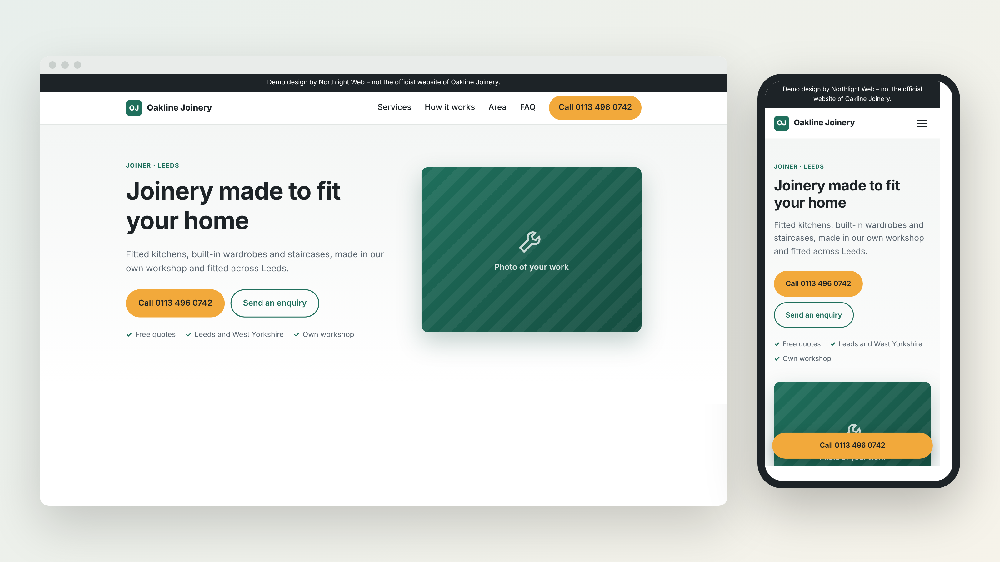

# web-outreach-demo

[](LICENSE)
[](https://claude.com/claude-code)
[](#about)

**Stop pitching. Start showing.**

Cold e-mails saying "your website could be better" get ignored. An e-mail with
the prospect's own new website gets a reply.

This Claude skill runs a 4-agent pipeline that does the boring part of finding
clients for you:

- 🔍 **Finds** local businesses whose websites are stuck in 2012
- ✍️ **Writes** a short, personal e-mail for each, based on verified facts only
- 🎨 **Builds** a demo landing page in your own design
- 📦 **Packages** everything, with desktop and mobile screenshots, for you to review

You stay in control: nothing is sent or published until you say so.



*A demo generated for a fictional business. See the [full example run](examples/README.md): the prospects found, the e-mail, the demo and the overview.*

## About

A Claude skill that uses four sub-agents to find businesses with a poor website, write each of them a personalised e-mail and build a demo landing page based on your own template. It is meant for freelance web designers looking for clients.

🌍 **Works anywhere.** Pick any country, city and industry. The e-mails and demos are written natively in the local language (Czech, German, Spanish, English, …), with local formats and the polite form of address customary there, while the reports for you are in your own language.

## How it works

| # | Agent | Input | Output |
|---|-------|-------|--------|
| 1 | **Researcher** – finds websites, evaluates them, fills in contact, website issues, a summary of the business and the link | industry, location, number of candidates | `prospects.json` |
| 2 | **Copywriter** – writes a short, personal e-mail in the local language for every candidate with an e-mail address | `prospects.json`, sender details, language | `emails/<slug>.md` |
| 3 | **Landing page builder** – copies the template, translates it and fills it with the candidate's verified data | `prospects.json`, template, language | `demos/<slug>/` |
| 4 | **Assembler** – checks consistency, links the e-mail with the demo, takes screenshots and prepares final packages | everything above | `final/<slug>/`, `final/_overview.md` |

Before the agents start, the skill checks which e-mail marketing rules apply in the recipients' country and tells you what they mean for the run (see [Legal note](#legal-note)). Agent 1 runs first. Agents 2 and 3 run in parallel. Agent 4 runs last, takes desktop (1440 px) and mobile (390 px) screenshots of every demo, and the main thread then shows them to you as previews together with a summary table.

**Nothing is sent or published without your confirmation.** After a run, the skill only offers the next steps: deploying the demos as previews (e.g. Vercel), creating e-mail drafts (e.g. Gmail; never sending), or logging the outreach in a spreadsheet.

## Repository structure

```
.
├── SKILL.md        # skill definition (instructions for Claude)
├── README.md       # this documentation
├── LICENSE         # MIT
├── CONTRIBUTING.md # how to help
├── template/       # sample landing page template – replace with your own design
│   ├── index.html
│   ├── style.css
│   └── README.md
├── examples/       # a complete fictional run: prospects, e-mail, demo, screenshots
├── docs/           # images for this README
└── outreach/       # outputs of individual runs (git-ignored, they contain contacts)
    └── .gitkeep
```

## Installation

One command, for all your projects (Claude Code):

```bash
git clone https://github.com/danielrickl/web ~/.claude/skills/web-outreach-demo
```

Or for a single project only:

```bash
git clone https://github.com/danielrickl/web .claude/skills/web-outreach-demo
```

Update later with `git -C ~/.claude/skills/web-outreach-demo pull`.

Requirements:

- Claude with web search and web fetch (Agent 1)
- Playwright with Chromium for the screenshots (Agent 4 installs it if missing; without it you get the demos but no previews)

**Your own design:** the skill uses the bundled sample in [`template/`](template/README.md) unless your project has its own folder named `template`, `vzor` or `sablona` with an `index.html`. Put your design there and every demo will look like your work.

## Usage

Ask Claude for example:

> Find me 5 clients with a poor website: carpenters in Leeds, UK.

> Find 3 plumbers in Lyon with an outdated website and write to them in French.

> Najdi mi 5 klientů se špatným webem, truhláři Teplice.

### Inputs

The skill asks only for what is missing:

| Input | Default |
|-------|---------|
| Industry | tradespeople and small local businesses |
| Location | country + region or cities – no default, the skill asks |
| Number of candidates | 5 |
| Outreach language | main business language of the location (or of the prospect's website in multilingual countries) |
| Form of address | the polite business form customary in that language |
| Template folder | your project's `template`/`vzor`/`sablona` folder (depth ≤ 2), otherwise the bundled sample |
| Sender details | brand, phone, e-mail, website, company registration number, postal address – missing items are left as `[FILL IN]`, never invented |

### Outputs of a run

Each run creates `outreach/<YYYY-MM-DD>-<industry>-<city>/`:

```
outreach/2026-11-23-carpenters-leeds/
├── prospects.json             # candidates (Agent 1)
├── emails/
│   ├── <slug>.md              # e-mail drafts with {{DEMO_URL}} (Agent 2)
│   └── _no-email.md           # candidates with a phone number only
├── demos/
│   └── <slug>/
│       ├── index.html         # tailored demo (Agent 3)
│       └── _data-used.md      # what is verified and what is a placeholder
└── final/
    ├── _overview.md           # summary table and what you still need to fill in
    └── <slug>/
        ├── email.md           # final e-mail text
        ├── demo/              # copy of the demo
        ├── demo-<slug>.zip    # only if there is no URL for the demo
        ├── preview-desktop.png
        └── preview-mobile.png
```

### Candidate record (`prospects.json`)

```json
{
  "slug": "smith-joinery-leeds",
  "company": "Smith Joinery",
  "city": "Leeds",
  "country": "UK",
  "url": "http://example.co.uk",
  "language": "en",
  "contact": {"email": "", "phone": "", "contact_source": "website / business directory / business register"},
  "what_they_do": "1-3 sentence summary verified from their website",
  "issues": ["no HTTPS", "not responsive", "no contact above the fold"],
  "score": 4,
  "verified_facts": ["services", "service area", "opening hours"],
  "unknown_data": ["prices", "references", "photos"]
}
```

`score` is 1–5 (5 = worst website, best candidate). Only candidates with a score of 4 or more and at least three specific, verifiable issues are selected.

## Principles

- **Verified facts only** – every claim about a prospect's website has a source; unknown data (prices, references, reviews, photos) is never invented.
- **Kind tone** – the goal is to offer help, not to shame. E-mails are around 120–150 words, without invented statistics or false urgency.
- **Demos are clearly labelled** – each demo says it is a design proposal, not the business's official website, and carries `noindex,nofollow`.
- **Minimal personal data** – only publicly listed business contacts.
- **Opt-outs are respected** – anyone who replies "no" is recorded and not contacted again.

## Legal note

The e-mails are commercial communications, and the rules depend on the **recipient's** country. Rough guide (the skill shows the relevant one at the start of every run):

| Jurisdiction | Unsolicited e-mail to businesses |
|--------------|----------------------------------|
| USA (CAN-SPAM) | Allowed with an honest subject, a clear sender, a postal address and an opt-out. |
| UK (PECR) | Allowed to companies with a clear sender and an opt-out; sole traders and partnerships need prior consent. |
| France | Generally allowed to a professional address if relevant to the recipient's profession, with an opt-out. |
| Germany (UWG § 7) | Prior express consent required, also for businesses. |
| Czech Republic (Act 480/2004 Coll., § 7) | Prior consent required, also for businesses (except existing customers). |
| Other EU countries | Check the national ePrivacy rules; many require consent. GDPR applies everywhere in the EU. |

Where consent is required, the skill recommends a different first contact (a phone call or a letter, which have their own rules) and writes e-mails only if you confirm. Always identify yourself, keep each message individual and honour every opt-out. This table is a simplification, not legal advice; check with a lawyer for your situation.

## Troubleshooting

- **No demos are created** – the template folder is missing or has no `index.html`; add `template/index.html` or give the skill the template path.
- **No screenshots** – Playwright/Chromium could not be installed or started; the reason is noted in `final/_overview.md` and the demos can be opened manually from `final/<slug>/demo/index.html`.
- **A candidate has no e-mail** – it is listed in `emails/_no-email.md` with a phone number for a call instead.
- **`[FILL IN]` in the outputs** – a sender detail was not provided; fill it in before sending.

## Contributing

New templates, legal notes for more countries and example runs in other languages are very welcome. See [CONTRIBUTING.md](CONTRIBUTING.md).

## License

[MIT](LICENSE) – free to use, modify and share, including commercially.
